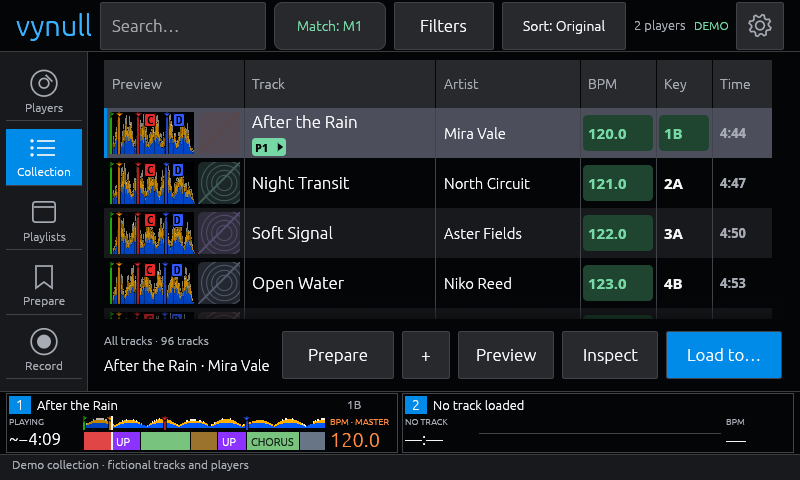
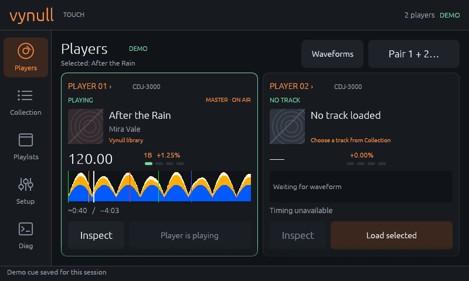
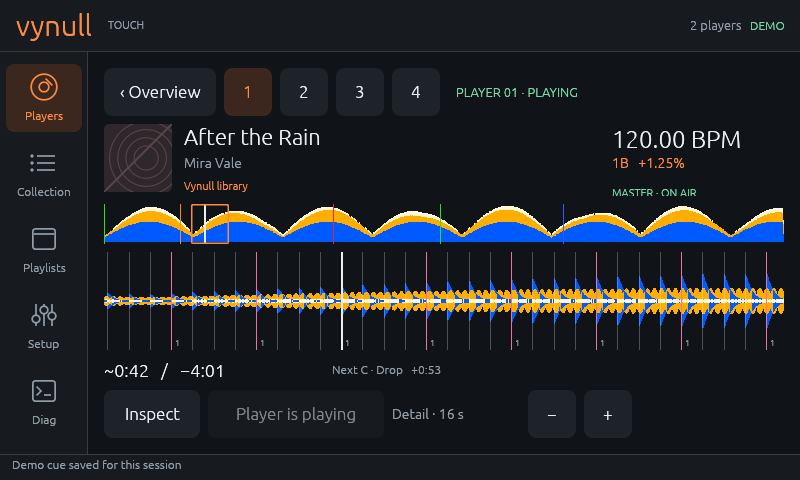
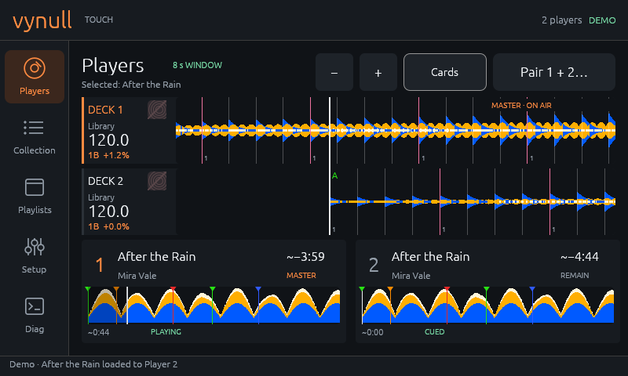
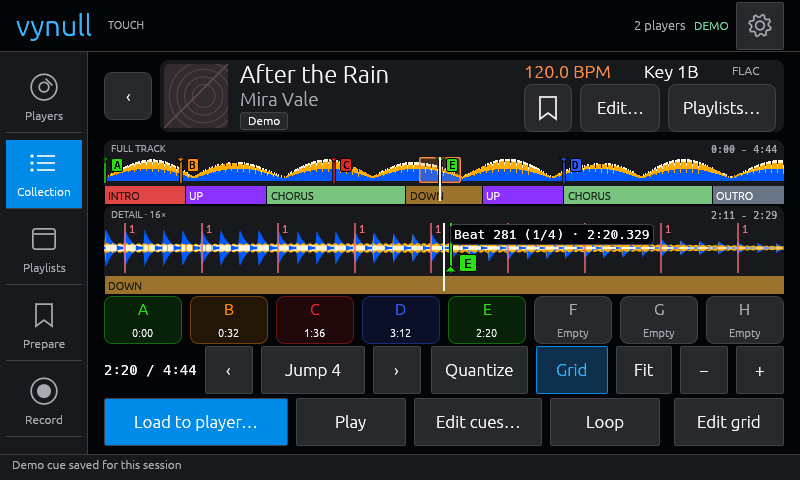
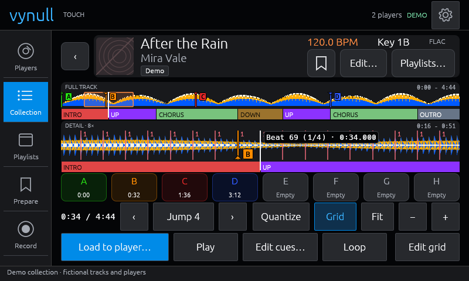
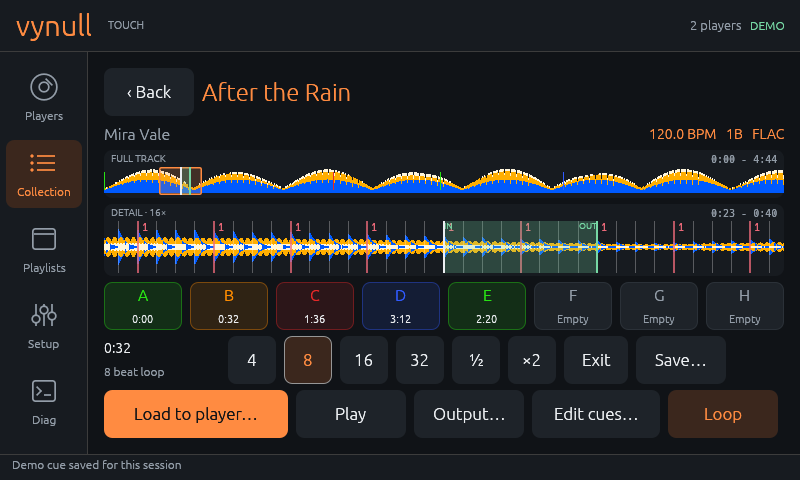
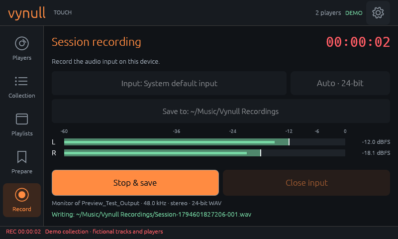

# Vynull Touch

[](https://github.com/vynulldev/vynull-touch/actions/workflows/ci.yml)
[](https://github.com/vynulldev/vynull-touch/releases)
[](LICENSE)
[](rust-toolchain.toml)


A native Rust touchscreen companion for [Vynull](https://github.com/vynulldev/vynull):
browse the library, prepare tracks, and monitor and load the decks. It is built for
an **800×480 landscape display** and adapts to 1024×600 and larger windows. See the
[roadmap](ROADMAP.md) for what's next.















## Before you start

This is a hobby project: a touchscreen companion for [Vynull](https://github.com/vynulldev/vynull),
which is a hobby project too. It isn't affiliated with Pioneer DJ / AlphaTheta.

It's a work in progress. Most of it is covered by automated tests and the demo,
but hasn't been checked on a physical touchscreen or with live CDJs yet (see the
[roadmap](ROADMAP.md)), so expect bugs, rough edges and layouts that still change.
Bug reports and PRs are welcome.

Use it at your own risk. Edits to tags, playlists, cues, beat grids and the CDJ
and mixer settings write to your Vynull library and settings, so back up your
library first, and **Load to…** loads real decks. Don't rely on it at a real gig.

## Try it

```sh
cargo run --locked -- --demo
```

Demo mode has 96 fictional tracks, four playlists, generated waveforms and two
simulated players, and makes no network requests. To use a running Vynull:

```sh
cargo run --locked -- --server http://127.0.0.1:9443
cargo run --release --locked -- --server http://vynull.local:9443 --fullscreen
```

The last server that connected is remembered, so later launches can omit
`--server`. `--startup-page players|collection|playlists` overrides the saved
start tab for one launch; command-line options always win over saved settings.
The app doesn't start Vynull: if Vynull runs on another machine, give it a
`--listen` address the touchscreen can reach.

## What it does

**Library**

- **Collection and playlists:** a table with artwork, waveform previews with hot
  cue markers, and Track, Artist, BPM, Key and Time columns. Drag to scroll, tap to
  select, then **Preview**, **Inspect** or **Load to…**. Smart playlists and
  folders have their own icons.
- **Search** with a built-in keyboard; results update as you type
  ([800×480](docs/keyboard-800x480.png), [1280×800](docs/search-results-1280x800.png)).
- **Sort** by any column (tap a heading) or from the menu, and **filter** by BPM
  range, key, genre, rating, color and tags. Sorting is remembered across restarts.
- **Match highlighting:** Key and BPM cells turn green when they fit the master
  deck or a player you choose in the toolbar's **Match** button. **Key rules…**
  sets which Camelot neighbours count (relative A/B, +1, −1); the BPM range is ±6%
  by default, with ±3%, ±10% and half/double time.
- **On-deck badges:** P1–P4 under a track's title when it's loaded on a player:
  green while playing, orange outlines when cued or paused.
- **Prepare:** a shortlist kept in a shared Vynull playlist. Add tracks from
  Collection, Inspect (the bookmark button) or Match; reorder, remove, inspect or
  load them from the Prepare tab.
- **Match a player:** find tracks that fit a deck's pitched tempo and key, then
  inspect, add to a playlist or load them.
- **Editing:** rating, color and tags per track (**Edit track…**); tag, category,
  playlist and folder management. Every edit is checked against the current
  library and read back before it shows as saved; failed or uncertain saves keep
  the draft and ask for **Reload**. Nothing is retried automatically.

**Inspect**

- Full-track and detailed waveforms with the beat grid, phrase strips (INTRO, UP,
  CHORUS and so on, colored by label), zoom up to 256× and **Fit**.
- Local audio preview, a millisecond cursor readout, **Quantize**, beat jumps of
  1–32 beats, and beat loops with **½ / ×2**.
- Hot cues A–H: tap an empty pad to set one, tap to jump, hold to edit. **Edit
  cues…** moves, labels and colors hot and memory cues in rekordbox's 16 cue colors
  ([previews](docs/cue-preview-800x480.png), [Inspect](docs/cue-inspect-800x480.png),
  [zoomed out](docs/cue-inspect-fit-1280x800.png)).
- **Edit grid:** nudge the grid by 0.1–50 ms, set beat 1 at the cursor, or type a
  BPM, with **Undo / Redo** (Ctrl+Z, Ctrl+Shift+Z). **Analysis lock** protects a
  grid from edits and re-analysis.
- **Back** or Escape returns to wherever Inspect was opened from, with its
  selection, scroll and view intact. Previewing never moves a deck.

**Players**

- **Waveforms** (the default): two stacked scrolling waveforms with aligned
  playheads, after the OPUS-QUAD. **Cards** shows two or four players with artwork
  and overviews; tap a player for its full-width view. **Pair…** picks any two.
- Playheads are estimated from Link status between updates, held CUE included.
  Times marked **~** are estimates; stale status hides the live playhead and
  disables loading.
- Phrase strips with the current section, and bars/beats countdowns to the next
  phrase and the next cue.
- **Load to…** sends a track to a player after checking the library, track and
  player again. Replacing a playing track asks first; the load is confirmed from
  the player's status.

**Settings**

- Server, startup tab, waveform style (Auto, RGB, 3-band, Blue) and full-track
  shape, preview audio output and volume.
- **Cue colors…:** a default color for each hot cue pad A–H.
- **Key matching…:** the Camelot neighbour rules.
- **CDJ & mixer…:** Vynull's shared CDJ, display and mixer settings (46 fields),
  and the CDJ menu's categories, sort options and detail column.
- **Diagnostics:** status, versions, request errors, the Vynull log, and a report
  to copy.

**Record**

Record the stereo audio input of the device running Touch (on the Pi, a HiFiBerry
or the system default) to WAV: 16- or 24-bit, Auto or 44.1–192 kHz. **Check
levels** shows the meters without recording. Recording continues across tabs and
reconnects, with a **REC** timer in the status bar, and splits into numbered parts
near 1 GiB. Files never overwrite each other; the default folder is
`~/Music/Vynull Recordings`.



Escape closes the keyboard or a dialog, returns from Inspect, or leaves
fullscreen; mouse and keyboard work too. Settings are saved in
`$XDG_CONFIG_HOME/vynull-touch/settings.json` (or `~/.config/vynull-touch/`).
If the connection drops, the app retries with backoff (**Retry now** skips the
wait) and keeps your place; library and cue changes from other clients refresh
in the background.

## What it needs from Vynull

- **Loading and editing:** library-session identity (Vynull #169):
  `library_session` in `/api/tracks/rev` and the `X-Vynull-Library-Session`
  header. Older servers can still be browsed.
- **Background refresh:** track revisions; cue refresh also needs the cue
  revision and batch endpoints. Without them, use **Refresh**.
- **Cue labels and confirmed saves:** Vynull #175 and #170.
- **Grid editing:** `/api/tracks/{id}/beats`, `/api/analysis/beatgrid/adjust` and
  `/api/tracks/{id}/lock`; Undo/Redo needs `/api/analysis/beatgrid/restore`
  (Vynull #183) and is disabled without it.
- **Preview audio:** `/api/audio/{id}?transcode=1`, which needs ffmpeg on the
  Vynull machine.
- **Optional:** phrases, 3-band waveforms, `/api/version` and `/api/diag/logs`.
  Without them those views say so and the rest keeps working.

## Raspberry Pi setup

Use a Pi 4 or 5 with a 64-bit desktop session (Wayland or X11) and Mesa
OpenGL/OpenGL ES. The app uses [eframe/egui 0.37](https://docs.rs/eframe/0.37.0/eframe/)
with its Glow renderer and rodio/CPAL audio (PipeWire/PulseAudio, or ALSA). It
needs a desktop compositor; it doesn't draw to DRM or `/dev/fb0`.

```sh
sudo apt install build-essential pkg-config cmake libx11-dev libxkbcommon-dev \
  libwayland-dev libegl1-mesa-dev libgl1-mesa-dev libasound2-dev libpulse-dev
cargo build --release --locked -j 2
./target/release/vynull-touch --fullscreen --server http://127.0.0.1:9443
```

`rust-toolchain.toml` pins Rust 1.99.0. To start the UI after desktop login,
install the binary and copy the autostart entry, editing its `Exec` address if
Vynull is remote:

```sh
sudo install -m 755 target/release/vynull-touch /usr/local/bin/vynull-touch
mkdir -p ~/.config/autostart && cp packaging/vynull-touch.desktop ~/.config/autostart/
```

Keep at least 800×480 logical pixels after scaling; `--size 1024x600` and
`--scale 1.25` help try other displays.

## Releases

[`scripts/release.py`](scripts/release.py) builds natively, runs the release tests,
and installs or rolls back. Each build keeps its source snapshot, logs and a
checksummed artifact; installs replace the binary atomically and keep the
previous one for rollback. It never installs packages or toolchains, and Cargo
runs offline unless you pass `--online`.

```sh
python3 scripts/release.py build --build-dir DIR
python3 scripts/release.py install --artifact DIR
python3 scripts/release.py rollback
```

`--restart` restarts an open UI after an install or rollback. Installs go to
`~/.local/bin` with records in `~/.local/state/vynull-touch/releases` unless
`--bin-dir` and `--state-dir` say otherwise. The build ID shows in **Settings →
Diagnostics** and in `vynull-touch --version`.

## Development

```sh
cargo fmt --check
cargo clippy --locked --all-targets -- -D warnings
cargo test --locked
python3 -m unittest discover -s scripts -p test_release.py
```

The tests cover touch interactions at 800×480, 1024×600 and 1280×800, the HTTP
contracts against local fixtures (they need loopback sockets), and the workers'
handling of stale replies and session changes. An opt-in test plays a real track
through a running Vynull:

```sh
VYNULL_AUDIO_TEST_ORIGIN=http://127.0.0.1:9443 VYNULL_AUDIO_TEST_TRACK=123 \
  cargo test --locked live_preview_play_pause_seek_and_end -- --ignored --nocapture
```

`python3 scripts/capture.py` captures native screenshots of the demo on a private
Xvfb display (it needs Xvfb, libXtst, xwininfo, xclip and ImageMagick; the audio
captures also need PulseAudio), and `--help` lists a capture for each feature.
Screenshots go to a new temporary folder unless you pass `--output-dir`; the
script never touches real players or a real library. Only the images linked here
belong in `docs/`.

Library requests, player status, artwork, deck analysis, preview audio, logs and
recording each run on their own bounded worker, so a slow request never stalls
the deck monitor. Player status is polled about every 250 ms.

GPL-3.0-or-later. See [LICENSE](LICENSE).
